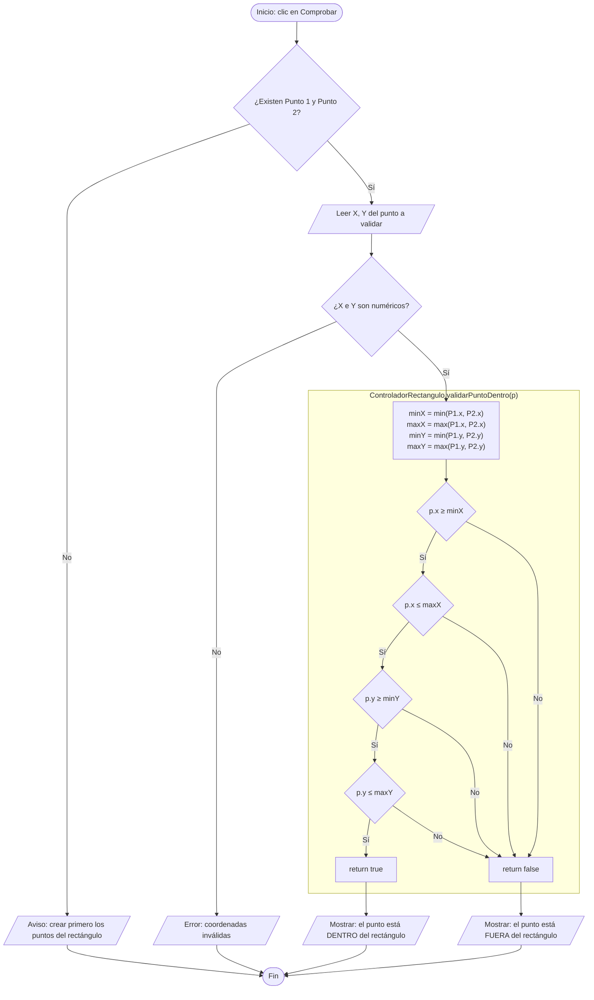

# Gestor de Figuras: Clase Rectángulo con Interfaz Gráfica
# gestor-de-figuras-geometricas

Aplicación de escritorio con interfaz gráfica para crear un rectángulo a partir de dos puntos (vértices opuestos), dibujarlo en un plano cartesiano, calcular su área y comprobar si un punto está dentro o fuera de la figura. Está desarrollada con Java Swing (JFrame) en NetBeans, sin librerías externas.

## Requisitos

- JDK 26
- Apache NetBeans (o cualquier IDE compatible con Java Swing)
- Maven (incluido en NetBeans)

## Estructura del proyecto

```
src/main/java/
├── modelo/
│   ├── Punto.java                    (coordenadas x, y)
│   ├── FiguraGeometrica.java         (superclase abstracta)
│   └── Rectangulo.java               (subclase)
├── vista/
│   └── VistaRectangulo.java          (JFrame)
├── controlador/
│   └── ControladorRectangulo.java
└── principal/
    └── main.java                     (clase principal)
```

## Patrón MVC

| Capa | Clase | Responsabilidad |
|------|-------|-----------------|
| Modelo | `Punto`, `FiguraGeometrica`, `Rectangulo` | Datos y reglas matemáticas de la figura (área y desplazamiento). |
| Vista | `VistaRectangulo` | Interfaz gráfica: campos de texto, botones y panel de dibujo. |
| Controlador | `ControladorRectangulo` | Lógica de cálculo: obtiene el área y valida si un punto está dentro del rectángulo. |
| Principal | `main` | Lanza la interfaz con `SwingUtilities.invokeLater`. |

## Descripción de las clases

- **Punto:** representa una coordenada `(x, y)` con atributos privados, getters y setters.
- **FiguraGeometrica (abstracta):** define los métodos abstractos `calcularArea()` y `mover(dx, dy)`.
- **Rectangulo extends FiguraGeometrica:** está compuesto por dos objetos `Punto` (`p1` y `p2`, vértices opuestos).
  - `calcularArea()`: base × altura, donde `base = |x2 − x1|` y `altura = |y2 − y1|`.
  - `mover(dx, dy)`: desplaza ambos vértices sumando `dx` a las X y `dy` a las Y.
- **ControladorRectangulo:** recibe un `Rectangulo` y ofrece `obtenerArea()` y `validarPuntoDentro(Punto p)`.
- **VistaRectangulo:** formulario para ingresar los dos puntos, botón para calcular el área, secciones para validar puntos y un panel que dibuja el plano cartesiano con el rectángulo.
- **main:** crea y muestra `VistaRectangulo`.

## Conceptos de POO aplicados

- **Herencia:** `Rectangulo` hereda de `FiguraGeometrica`.
- **Clase abstracta y polimorfismo:** `FiguraGeometrica` declara `calcularArea()` y `mover()` sin implementarlos; `Rectangulo` los sobreescribe (`@Override`) con la fórmula propia de un rectángulo (base × altura, calculadas con la diferencia de coordenadas).
- **Composición:** un `Rectangulo` *tiene* dos `Punto`.
- **Sobreescritura (Override) en la vista:** el panel de dibujo es una clase anónima de `JPanel` que sobreescribe `paintComponent` para dibujar los ejes, el rectángulo y los puntos.
- **Encapsulamiento:** atributos privados con getters y setters públicos.

### Lógica de "punto dentro del rectángulo"

El controlador calcula los límites del rectángulo con `min` y `max` (así no importa en qué orden se ingresen los vértices) y verifica que la coordenada X del punto esté entre `minX` y `maxX`, y que la coordenada Y esté entre `minY` y `maxY`. Los puntos sobre el borde se consideran dentro.

## Diagrama de clases (UML)

```mermaid
classDiagram
    class Punto {
        -double x
        -double y
        +Punto(double x, double y)
        +getX() double
        +setX(double x) void
        +getY() double
        +setY(double y) void
    }

    class FiguraGeometrica {
        <<abstract>>
        +calcularArea() double*
        +mover(double dx, double dy) void*
    }

    class Rectangulo {
        -Punto p1
        -Punto p2
        +Rectangulo(Punto p1, Punto p2)
        +getP1() Punto
        +getP2() Punto
        +calcularArea() double
        +mover(double dx, double dy) void
    }

    class ControladorRectangulo {
        -Rectangulo rectangulo
        +ControladorRectangulo(Rectangulo rectangulo)
        +obtenerArea() double
        +validarPuntoDentro(Punto p) boolean
    }

    class VistaRectangulo {
        -Punto punto1
        -Punto punto2
        -JPanel lienzo
        +VistaRectangulo()
        -leerPunto(JTextField campoX, JTextField campoY) Punto
        -validarPunto(JTextField campoX, JTextField campoY) void
        -dibujar(Graphics g) void
    }

    class main {
        +main(String[] args)$ void
    }

    FiguraGeometrica <|-- Rectangulo
    Rectangulo "1" *-- "2" Punto : 
    ControladorRectangulo "1" --> "1" 
    VistaRectangulo ..> ControladorRectangulo : 
    VistaRectangulo ..> Rectangulo : 
    VistaRectangulo ..> Punto : 
    main ..> VistaRectangulo : 
```

### Relaciones y cardinalidades

- **Herencia (`FiguraGeometrica` ← `Rectangulo`):** un `Rectangulo` es exactamente una `FiguraGeometrica` (1..1).
- **Composición (`Rectangulo` ◆— `Punto`):** un `Rectangulo` está formado por exactamente 2 `Punto` (1..2); en el código son los atributos `p1` y `p2`.
- **Asociación (`ControladorRectangulo` → `Rectangulo`):** un controlador trabaja con un único rectángulo (1..1).
- **Dependencia (`VistaRectangulo` ⇢ `ControladorRectangulo`, `Rectangulo`, `Punto`):** la vista crea los puntos, arma el rectángulo y se lo entrega al controlador cuando calcula el área o valida un punto.
- **Dependencia (`main` ⇢ `VistaRectangulo`):** la clase principal crea y muestra la vista.

## Diagrama de flujo: validación de punto dentro del rectángulo



Las cuatro comprobaciones encadenadas equivalen a la condición `p.x ≥ minX AND p.x ≤ maxX AND p.y ≥ minY AND p.y ≤ maxY`. El punto está fuera si falla cualquiera de ellas: `p.x < minX OR p.x > maxX OR p.y < minY OR p.y > maxY`.

Los pasos dentro del recuadro los ejecuta `ControladorRectangulo`; la lectura de datos y los mensajes los maneja `VistaRectangulo`.

## Uso de la aplicación

1. **Crear los puntos:** escribir X1 y Y1 y pulsar **Crear Punto 1**; escribir X2 y Y2 y pulsar **Crear Punto 2**. Los puntos (P1 en rojo, P2 en azul) y el rectángulo se dibujan en el plano.
2. **Calcular el área:** pulsar **Calcular Area**. El resultado aparece en la etiqueta de área.
3. **Validar un punto:** en la sección *Validar punto 1* o *Validar punto 2*, escribir X e Y y pulsar **Comprobar**. Un mensaje indica si el punto está dentro o fuera del rectángulo.

Los decimales se escriben con punto (por ejemplo `2.5`).

### Panel de dibujo

- El origen `(0, 0)` está en el centro del panel.
- La escala es de 20 píxeles por cada unidad.
- El eje Y positivo apunta hacia arriba.

## Validaciones

- Las coordenadas deben ser numéricas; si no, se muestra un mensaje de error.
- Para validar un punto, primero deben existir el Punto 1 y el Punto 2.
